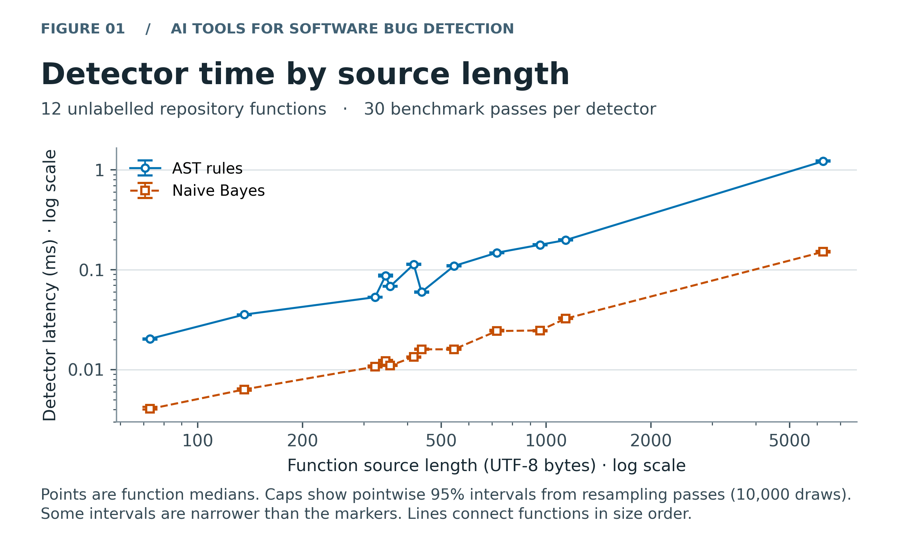
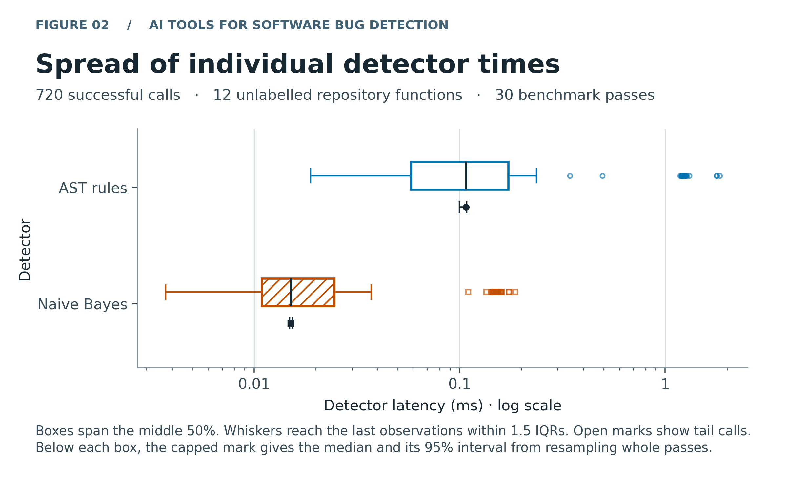

# AI Tools for Software Bug Detection

Baltabay Aidos and Bissen Yerkebulan · Digital Engineering · Tasks 2 and 3

This project compares fixed Python AST rules with a supervised multinomial Naive Bayes classifier for division by zero and unintended state sharing through mutable default arguments. Task 3 measures scoring time on 12 functions from the Task 2 repository. Eight labelled synthetic test fixtures check the quality calculations. Independently reviewed real-code labels are still needed to evaluate the registered F1 hypothesis.

[Executed notebook](notebooks/01_data_analysis.ipynb) · [Standalone Task 3 report (PDF)](reports/task3_report.pdf) · [Mathematical model](docs/domain_model.md)

## Results & Discussion

On 3 November 2026, each method scored the same 12 unlabelled functions from two files in one repository. The functions span 73–6,244 bytes. Each method made 360 measured calls on these functions across 30 passes. The faster median for Naive Bayes describes the cost of scoring this fixed workload on one host.

Repository functions | Baseline · AST rules | Proposed · Naive Bayes
--- | ---: | ---:
Median latency, ms (p25–p75) | 0.1073 (0.0580–0.1726) | 0.0151 (0.0109–0.0245)
95% bootstrap CI for median, ms | 0.1000–0.1081 | 0.0149–0.0154
p95 / p99 latency, ms | 1.2150 / 1.2916 | 0.1513 / 0.1603
Detector throughput, snippets/s (95% CI) | 5,017 (4,856–5,162) | 35,866 (34,237–37,108)
Measured errors / attempts | 0 / 360 | 0 / 360

**Figure 1.** Each point is a function's median time. Caps give pointwise 95% bootstrap intervals across the 30 passes. Both methods took longer on the largest function than on the smallest. Source length measures the input size of this offline detector. Syntax and token composition also differ among functions.



**Figure 2.** The middle half of AST calls spans 0.0580–0.1726 ms and the middle half of NB calls spans 0.0109–0.0245 ms. Whiskers reach the last observations within 1.5 IQRs of the quartiles. Open symbols show the remaining calls. Separate capped marks show pass-bootstrap 95% intervals for the pooled medians.



### Quality check on the eight labelled fixtures

Metric | Baseline · AST rules | Proposed · Naive Bayes
--- | ---: | ---:
TP / FP / TN / FN | 4 / 0 / 4 / 0 | 4 / 2 / 2 / 0
Precision / recall / F1 | 1.000 / 1.000 / 1.000 | 0.667 / 1.000 / 0.800
False-positive rate | 0 / 4 = 0.00 | 2 / 4 = 0.50

NB flagged both negative division-by-zero fixtures. Both detectors classified all four mutable-default fixtures as expected. Each snippet contributes once to these counts. The F1 difference (NB minus AST) was −0.200. Resampling four synthetic project groups gave a 95% interval of [−0.333, 0.000], with 10,000 of 10,000 paired draws valid. This reproduces the Task 2 smoke check. F1 and FPR are undefined for the 12 unlabelled functions. [Per-family counts](data/processed/fixture_categories.csv)

### Measurement and guardrails

- The collector trained NB on the eight original training fixtures using α = 1 and threshold 0.5. Five warm-up passes produced 200 calls. Thirty benchmark passes produced 1,200 calls across both corpora, including 480 on the test fixtures. Seed 42 controls the order of inputs and methods. Both methods receive the same source text, which is parsed or tokenized without execution.
- Each timer surrounds one detector call. Training, logging and file reads are outside it. Throughput is completed calls divided by the total time inside the scorer. The CSV includes mean, sample SD, median, p95 and p99. A 10,000-draw bootstrap resamples whole passes, keeping the input mix and the pairing. Flagged outliers stay in the estimates. [Full CSV](data/processed/metrics_summary.csv)
- The collection used the original Debian image, CPython 3.12.10 and Linux/arm64 on an Apple M3 host. Docker enforced one CPU of quota and a 512 MiB memory limit. Fitting took 0.089 ms. The shared collector's peak RSS through the final call was 20.83 MiB (limit 256 MiB). This covers training and buffered events. The separate notebook process runs later. The guest advertised a 1 ms clock resolution. A 50,000-pair probe observed increments as small as 41 ns. Times are observations on this virtualized host.
- Each method met the 100 ms p95 limit on both workloads. All 1,400 attempted calls succeeded. On the fixtures, NB exceeded the 0.10 FPR limit. The full research success criterion remains unevaluated.

## Reproduce the Task 3 analysis

From the repository root on macOS or Linux, use Python 3.12 (tested with 3.12.10). The installed analysis packages are separate from the standard-library Task 2 benchmark.

```bash
python3.12 -m venv .venv
source .venv/bin/activate
python -m pip install -r requirements-task3.txt
python -m unittest discover -s tests -v
python -m src.collect_task3 --verify-model
jupyter nbconvert --to notebook --execute --inplace --ExecutePreprocessor.timeout=180 notebooks/01_data_analysis.ipynb
```

The notebook starts a new Python kernel, validates the archived [JSONL](data/raw/test_run.jsonl) and regenerates both CSVs and both figure pairs. To inspect the saved outputs interactively, open it with `jupyter lab notebooks/01_data_analysis.ipynb`. The same calculations are available separately via `python -m src.process_data` and `python -m src.visualize`.

On the delivered run, all 13 tests passed, including checks for incomplete logs, warm-up exclusion, timing units, failed calls and repeat-level resampling. Reloading the saved model reproduced 700 NB scores and decisions over 20 distinct inputs. The archived log has SHA-256 `ef7a7fb5a6208d53768159fba07af7f2e5d20891e969d851bc27ac46b18a4685`.

### Collect another timed run

The collector selects six functions by size rank from each of the two frozen source files. The JSONL header records line ranges, names, byte counts, SHA-256 hashes, parameters and environment. Each call records its phase, input, method, elapsed nanoseconds, prediction and status. A final record gives completion counts and process RSS. The small [JSON model](models/task3_nb.json) stores the learned log priors and token likelihoods. Model verification reloads it and reproduces its scores and decisions.

Run these commands from the repository root. New measurements go to the ignored `results/task3-repeat/` directory so the archived observations remain available for comparison.

```bash
task3_image=$(awk '/^FROM / {print $2; exit}' Dockerfile)
docker pull "$task3_image"
task3_image_id=$(docker image inspect --format '{{.Id}}' "$task3_image")
mkdir -p results/task3-repeat
docker run --rm --network none --user "$(id -u):$(id -g)" --cpus=1 --memory=512m --memory-swap=512m \
  -e PYTHONHASHSEED=42 -e PYTHONDONTWRITEBYTECODE=1 -e TASK3_IMAGE_ID="$task3_image_id" \
  -v "$PWD:/app:ro" -v "$PWD/results/task3-repeat:/out" -w /app "$task3_image" \
  python -m src.collect_task3 --raw /out/test_run.jsonl --model /out/model.json
python -m src.collect_task3 --verify-model --raw results/task3-repeat/test_run.jsonl --model results/task3-repeat/model.json
python -m src.process_data --raw results/task3-repeat/test_run.jsonl --out results/task3-repeat
python -m src.visualize --raw results/task3-repeat/test_run.jsonl --output-dir results/task3-repeat/figures
```

## Task 2 instrument and registered research protocol

The original smoke benchmark runs with the Python standard library. From the repository root, run `python3 src/benchmark.py --config configs/smoke.json` or use the original container workflow.

```bash
docker build -t ai-bug-detection-task2:1.0 .
docker run --rm --cpus=1 --memory=512m -v "$PWD/results:/app/results" ai-bug-detection-task2:1.0
```

The registered comparison needs at least 50 reviewed training snippets and 100 reviewed test snippets from at least 10 held-out test projects. The two authors must independently label both defect families, reconcile disagreements, document provenance and remove cross-split duplicates. After freezing that dataset, run `python3 src/benchmark.py --config configs/research.json`. The primary endpoint is the paired difference in F1. The protocol requires a positive lower 95% bound, an absolute gain of at least 0.05 and compliance with the guardrails for practical success. [Methodology passport](docs/methodology_passport.pdf) · [Data protocol](docs/data_protocol.md)

## Sources and licence

The detectors, fixtures and unlabelled inputs come from the original MIT-licensed project. The implementation, Task 2 reproducibility notes, source bibliography and citation metadata remain available with the project. [Frozen Task 2 revision](https://github.com/aidos779/ai-bug-detection-task2/tree/374dea01bd5983d9081e94f8a8dccb47168ab94a) · [Task 2 reproducibility](docs/reproducibility.md) · [References](docs/references.bib) · [Citation](CITATION.cff) · [MIT licence](LICENSE)
